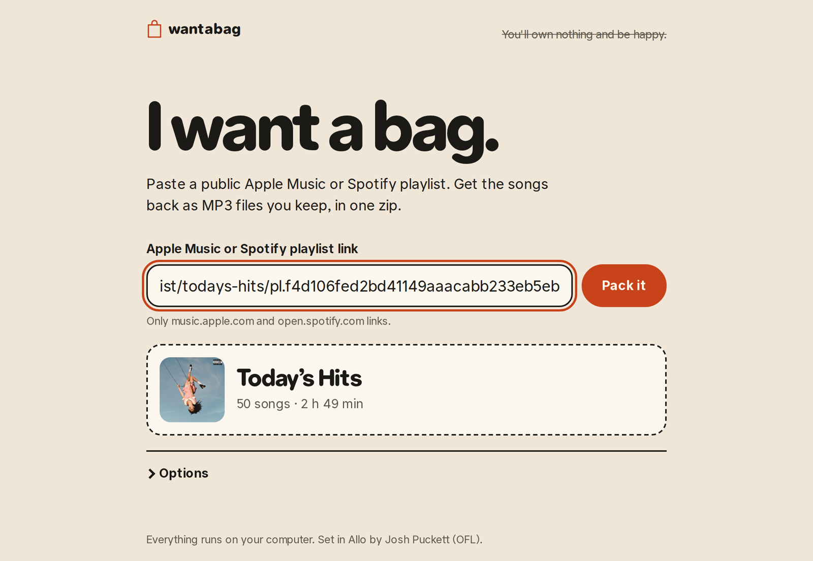

# wantabag

Keep a copy of your streaming playlists as plain files. Paste a public Apple Music or Spotify
playlist and wantabag finds every song on public sources and saves it as a tagged MP3 (cover art
included), from the command line or a small local web page. It can follow your playlists and
fetch new songs every day.



## Why

> *"You'll own nothing and be happy."* No, thanks. I want a bag.

With streaming you rent access to music: catalogs change, songs disappear, prices go up and the
library goes with the account. A record or a CD was yours. wantabag keeps an ordinary copy of
the playlists you care about, readable by any player, phone or car.

It is a personal tool and it runs only on your computer: see the [legal note](#legal-note).

## What it does (and does not)

- Reads a **public** Apple Music or Spotify playlist and gets the list of songs from the data
  the public page itself carries. No account and no keys are needed. For Spotify you can
  optionally add your **own** API credentials (see Limitations). It never uses other people's
  tokens or private APIs.
- Searches each song on public sources (YouTube Music / YouTube through
  [yt-dlp](https://github.com/yt-dlp/yt-dlp)), picks the best match by duration, title and
  artist, and prefers official audio over live versions and covers.
- Saves `<folder>/<playlist>/<Artist> - <Title>.mp3` with full ID3 tags (title, artist, album,
  track number in the playlist, embedded cover art, and the ISRC when the source gives it) and one `.m3u` file per playlist.
- Optionally also downloads the music video (`.mp4`) in your preferred quality.
- **It never downloads, decrypts or bypasses protection of anything from Apple Music or
  Spotify.** They are only used as a list of songs.

## Requirements and installation

- Python 3.11 or newer
- [ffmpeg](https://ffmpeg.org/) installed on your system (wantabag checks for it and tells you
  how to install it if it is missing)
- [pipx](https://pipx.pypa.io/)

```sh
git clone <this repo> && cd wantabag
pipx install .
wantabag --version
```

Install ffmpeg with `sudo apt install ffmpeg` (Debian/Ubuntu), `sudo dnf install ffmpeg-free`
(Fedora), `sudo pacman -S ffmpeg` (Arch), `brew install ffmpeg` (macOS) or
`winget install Gyan.FFmpeg` (Windows).

YouTube extraction needs a JavaScript runtime. The `deno` runtime is installed together with
wantabag; if you prefer, node or bun on your `PATH` are used when deno is not available.

## Usage

Everything has a reasonable default, so you can start right away without any setup:

```sh
wantabag get "https://music.apple.com/us/playlist/todays-hits/pl.f4d106fed2bd41149aaacabb233eb5eb"
wantabag get "https://open.spotify.com/playlist/37i9dQZF1DXcBWIGoYBM5M" --out ~/Music/spotify
```

| Command | What it does |
|---|---|
| `wantabag get <url>` | Download a playlist once. Options: `--out DIR`, `--video/--no-video`, `--audio-quality`, `--video-quality`, `--limit N` (first N songs), `--name NAME` (folder name; default: the playlist's name), `--dry-run` (list the songs, download nothing) |
| `wantabag setup` | Interactive assistant that writes the configuration |
| `wantabag add <url>` | Follow a playlist (checks that it is public). `--name NAME` chooses the folder name |
| `wantabag list` | Show followed playlists and how many files each has |
| `wantabag remove <url or number>` | Stop following a playlist (files are kept) |
| `wantabag sync [url or number]` | Download only what is missing. Songs that failed are retried |
| `wantabag service install\|uninstall\|status` | Daily automatic sync. Add `--web` to manage the web interface service instead |
| `wantabag web` | Local web interface (see below). Options: `--host`, `--port`, `--open` |
| `wantabag searxng up\|down` | Optional SearXNG search backend |

Each song prints one status line. Add `-v` before the command to see yt-dlp output; real
failures are always listed in the missing report.

The folder is named after the playlist as the source serves it (Apple localizes names, so a
Spanish link may give "Favorite Songs"). Use `--name` to pick another one. A followed playlist
keeps its folder name even if it is renamed at the source; edit `name` in the config to change it.

`sync` keeps a local state (`~/.local/state/wantabag/state.json`), so songs already found are
not searched again, and files you already have are skipped. Songs that were removed from the
playlist are never deleted from your folder; they just leave the `.m3u`.

Songs that could not be found or downloaded are listed in
`<folder>/<playlist>/wantabag-missing.txt` and summarized in the terminal. They are retried at
the next sync. The exit code is `0` even when some songs are missing, `1` on errors (for
example, ffmpeg missing or no playlist could be read).

## Configuration

`wantabag setup` asks for the destination folder, audio quality, videos and their quality, the
playlists to follow (proposing each playlist's name as its folder name), and whether to install the daily service and the web interface service. It saves
`~/.config/wantabag/config.toml` (`$XDG_CONFIG_HOME` is respected), which you can also edit by
hand:

```toml
output_dir = "~/Music/wantabag"

[audio]
quality = "v0"            # v0 | 320 | 192 | 128

[video]
enabled = false
quality = "1080"          # 720 | 1080 | 2160 | best

[search]
backend = "youtube"       # youtube | searxng
searxng_url = ""

[spotify]                 # optional
client_id = ""
client_secret = ""

[[playlists]]
url = "https://music.apple.com/us/playlist/todays-hits/pl.f4d106fed2bd41149aaacabb233eb5eb"
name = "Today's Hits"     # folder name; filled in at the first sync if empty
```

Audio quality choices:

| Value | Meaning |
|---|---|
| `v0` (recommended) | MP3 VBR V0, about 245 kbps |
| `320` | MP3 320 kbps CBR |
| `192` | MP3 192 kbps |
| `128` | MP3 128 kbps |

The audio source (YouTube) is usually about 128–160 kbps Opus/AAC and rarely goes above
256 kbps, so a higher MP3 bitrate makes files bigger, not better.

## Web interface

```sh
wantabag web --open          # http://127.0.0.1:8765
```

Paste a playlist link and the page shows a preview (cover, name, number of songs, total
duration). Press **Pack it** and each song is searched, downloaded and tagged live; the songs
that could not be found are listed at the end under "Not in the bag". When it finishes you
download one `.zip` with the MP3 files and the `.m3u` (and the missing report). The audio quality,
folder name and music videos are under **Options**. It uses the same readers, search, download
and tagging as the command line, and needs only Python's standard library.

- It listens on `127.0.0.1` and **has no authentication**. If you pass another `--host`
  (for example `0.0.0.0`) the terminal warns you: anyone who can reach that address can use it.
  Requests with a foreign `Host` header and non-JSON POSTs are refused.
- Downloads live in a temporary folder and are **deleted** as soon as you have downloaded the
  zip, or one hour after they finish (and everything is removed when the server stops). Only
  one download runs at a time; up to five more wait in line.
- Only `https://music.apple.com` and `https://open.spotify.com` playlist links are accepted.
- The files are not saved in your music folder, nor do they touch `wantabag sync`'s state.
- To keep it running: `wantabag service install --web` (systemd user service on Linux,
  LaunchAgent on macOS), or answer yes in `wantabag setup`.

API, in case you want to script it (JSON; POST bodies must be `application/json`):

| Request | Result |
|---|---|
| `POST /api/preview {"url"}` | name, song count, duration and tracks, without downloading |
| `POST /api/jobs {"url", "quality"?, "name"?, "videos"?}` | `202 {"id", "events_url", "zip_url"}`. `videos` is `false`, `true` or `"720"`, `"1080"`, `"2160"`, `"best"` |
| `GET /api/jobs/<id>` | current state |
| `GET /api/jobs/<id>/events` | Server-Sent Events: `queued`, `playlist`, `track` (searching, downloading, done, not_found, failed), `end` |
| `GET /api/jobs/<id>/zip` | the zip, named after the playlist; the job is deleted afterwards |
| `GET /api/options` | the audio and video choices of `wantabag setup` |

## Daily service

```sh
wantabag service install     # sync every day
wantabag service status
wantabag service uninstall
wantabag service install --web   # also (or only) keep the web interface running
```

- **Linux:** a systemd *user* timer (`wantabag-sync.timer`, daily, with a random delay of up to
  30 minutes, and it catches up if the computer was off). Logs: `journalctl --user -u wantabag-sync`.
- **macOS:** a LaunchAgent (`io.github.wantabag.sync`) that runs every day at 10:00. Log:
  `~/Library/Logs/wantabag.log`.

Only one run at a time is allowed: if the timer is syncing and you start another run, it says
so and exits.

## Optional: SearXNG

By default wantabag searches YouTube directly through yt-dlp. If you prefer to use a
[SearXNG](https://github.com/searxng/searxng) instance:

```sh
wantabag searxng up      # starts a local container with docker and selects it as backend
wantabag searxng down    # stops it and goes back to the default search
```

To use an instance you already have, set `backend = "searxng"` and `searxng_url` in the config
(the instance must allow the JSON output format). If docker is not available, `searxng up`
explains what to do.

## Limitations

- Only **public** playlists can be read.
- **Spotify:** wantabag reads the public embed page, which has about the first 100 songs, no
  album and no ISRC, and warns you if the playlist looks truncated. The Web API is used only
  with your own client id/secret from `[spotify]` (never with the anonymous token of the web
  player). Since 2026 Spotify only returns playlist contents for playlists owned by the API
  user, so credentials may not help with other people's long playlists.
- **Apple Music:** wantabag reads only what the public page carries (title, artist, album,
  duration, cover; no ISRC). If the page declares more songs than it includes, wantabag warns
  that the list may be incomplete.
- Matching is automatic and not perfect. When nothing matches with enough confidence, the song
  goes to the missing report instead of downloading something wrong.
- Quality is limited by what the public sources offer.

## Credits

The web interface is set in [Allo](https://allo.joshpuckett.me/) by Josh Puckett, a
variable font under the SIL Open Font License 1.1 (`src/wantabag/web/static/fonts/OFL.txt`).

## Legal note

wantabag is meant for personal use, run on your own computer. It does not host, share or
distribute music, and it never downloads, decrypts or bypasses the protection of anything from
Apple Music or Spotify. Downloading from YouTube may go against its terms of service, and
private copy rules differ between countries (in some, the source must be lawful). You are
responsible for complying with the laws of your country and the terms of the sites involved.
Do not run it as a public service. wantabag is a tool; it does not give you the right to copy
anything.

## Development

```sh
python3 -m venv .venv && .venv/bin/pip install -e '.[dev]'
.venv/bin/ruff check . && .venv/bin/ruff format --check . && .venv/bin/pytest
```

Tests run without network access, using fixtures and simulated search and download.
